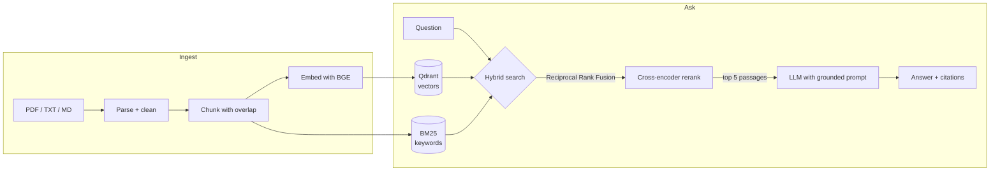

# AskDocs: Chat With Your Documents

**A retrieval-augmented generation (RAG) system that answers questions about your PDFs and text files, with every answer grounded in the source and cited down to the page.**


<!-- Add a screenshot or short GIF of the app here, e.g.  -->

---

## Overview

Organisations keep their answers in policies, manuals, contracts and reports. Keyword search misses paraphrased questions, and a general-purpose chatbot doesn't know the content and may invent answers.

AskDocs combines **hybrid retrieval** (semantic + keyword search), **cross-encoder reranking** and a **grounded LLM prompt**, so answers come only from your documents, cite the exact passages they use, and say so plainly when the documents don't contain the answer.

## Features

- **Hybrid search.** Dense embeddings (BGE) and BM25 keyword search run side by side and are merged with Reciprocal Rank Fusion. Paraphrased questions *and* exact terms (product codes, clause numbers, names) are both found.
- **Cross-encoder reranking.** A second-stage model re-scores the candidates, so the most relevant passages reach the LLM first.
- **Cited, grounded answers.** Every sentence references its source; each source shows its file, page and relevance score.
- **Streaming responses.** Answers appear token by token, typically in about a second on a laptop GPU.
- **Model-agnostic LLM layer.** Runs fully locally with Ollama, or with OpenAI, Groq, vLLM or any OpenAI-compatible API by changing one setting.
- **Measurable retrieval quality.** Built-in evaluation reports Hit@k, MRR and latency for each retrieval strategy.
- **Production-ready packaging.** REST API with interactive docs, Docker Compose deployment, unit tests and CI.

## How it works



1. **Ingest.** Documents are parsed page by page, cleaned, and split into overlapping chunks of about 1,000 characters. Each chunk is embedded and stored in Qdrant, and indexed for keyword search with BM25.
2. **Retrieve.** A question is matched against both indexes (top 20 each). The two ranked lists are merged with Reciprocal Rank Fusion, which needs no score calibration.
3. **Rerank.** A cross-encoder reads the question together with each candidate and keeps the 5 most relevant passages.
4. **Generate.** The LLM receives the numbered passages and a prompt that requires every claim to be cited and forbids answers the sources don't support.

## Tech stack

| Layer | Technology |
| --- | --- |
| Embeddings | `BAAI/bge-small-en-v1.5` (sentence-transformers) |
| Reranker | `cross-encoder/ms-marco-MiniLM-L-6-v2` |
| Vector database | Qdrant (embedded locally, server mode in Docker) |
| Keyword search | BM25 |
| LLM | Ollama (default: Qwen 2.5 3B) or any OpenAI-compatible API |
| Backend | FastAPI, Pydantic |
| Interface | Streamlit |
| Document parsing | PyMuPDF |
| Deployment | Docker Compose, GitHub Actions |

## Quickstart

**Requirements:** Python 3.10 or newer, and either [Ollama](https://ollama.com) for local models or an API key for OpenAI or Groq. An NVIDIA GPU is used automatically when available.

### Windows

```powershell
.\setup.ps1     # one-time: virtual environment, PyTorch (CUDA if available), dependencies, models
.\run.ps1       # starts the API and the chat interface, then opens your browser
```

If script execution is restricted on your machine, run the same scripts with `powershell -ExecutionPolicy Bypass -File .\setup.ps1`.

### macOS / Linux

```bash
bash setup.sh   # one-time setup
bash run.sh     # start the app
```

### Docker

```bash
docker compose up --build
```

The chat interface opens at http://localhost:8501 and the API docs at http://localhost:8000/docs. Click **Load sample document** in the sidebar to try it with a fictional employee handbook.

### Using a hosted LLM

Edit `.env` to point at any OpenAI-compatible provider, for example:

```ini
LLM_BASE_URL=https://api.openai.com/v1
LLM_API_KEY=sk-...
LLM_MODEL=gpt-4o-mini
```

## Configuration

All settings live in `.env` (see [.env.example](.env.example)) and can also be set as environment variables.

| Setting | Default | Description |
| --- | --- | --- |
| `LLM_BASE_URL` | `http://127.0.0.1:11434/v1` | OpenAI-compatible endpoint |
| `LLM_MODEL` | `qwen2.5:3b` | Model used to write answers |
| `EMBED_MODEL` | `BAAI/bge-small-en-v1.5` | Embedding model |
| `RERANK_MODEL` | `cross-encoder/ms-marco-MiniLM-L-6-v2` | Reranking model |
| `CHUNK_SIZE` / `CHUNK_OVERLAP` | `1000` / `150` | Chunk length and overlap, in characters |
| `CANDIDATES_K` / `TOP_K` | `20` / `5` | Candidates per retriever / passages given to the LLM |
| `QDRANT_URL` | not set | Use a Qdrant server instead of the embedded database |

## API

Interactive documentation is served at `/docs`.

| Method | Endpoint | Description |
| --- | --- | --- |
| `POST` | `/documents` | Upload and index one or more files |
| `GET` | `/documents` | List indexed documents and their chunk counts |
| `DELETE` | `/documents/{name}` | Remove a document |
| `POST` | `/ask` | Answer a question; returns the answer, sources and timings |
| `POST` | `/ask/stream` | Same as `/ask`, streamed as newline-delimited JSON events |
| `GET` | `/info` | Model, device and index status |

```bash
curl -X POST http://localhost:8000/ask -H "Content-Type: application/json" \
     -d '{"question": "How many days a week can I work remotely?"}'
```

## Evaluation

Retrieval quality is measured on a question set generated from your own documents: an LLM writes one question per sampled chunk, and that chunk becomes the expected answer.

```bash
python -m eval.generate_qa --n 50      # build the question set
python -m eval.eval_retrieval --k 5    # compare retrieval strategies
```

Run these with the app stopped. The report compares keyword-only, semantic-only, hybrid and hybrid + reranking retrieval on:

- **Hit@5**: how often the passage containing the answer is among the 5 passages given to the LLM.
- **MRR@5**: how high that passage ranks (1.0 = always first).
- **Latency** per query.

## Project structure

```
askdocs/
  config.py       settings, loaded from .env
  ingest.py       parsing, cleaning and chunking
  models.py       embedding and reranking models
  store.py        Qdrant vector store and BM25 keyword index
  retriever.py    hybrid retrieval, rank fusion and reranking
  pipeline.py     orchestration, prompting and streaming generation
  api.py          FastAPI application
app/
  streamlit_app.py  chat interface
eval/             retrieval benchmark
sample_docs/      sample document for demos
tests/            unit tests
run.py            starts the API and interface together
```

## Development

```bash
pip install -r requirements-dev.txt
python -m pytest        # unit tests
python -m ruff check .  # linting
```

## Design notes

- **Framework-light core.** The retrieval pipeline is written in plain Python on top of well-known libraries, keeping every stage transparent and tunable. It ports easily to LangChain or LlamaIndex when a project calls for it.
- **Rank-based fusion.** Reciprocal Rank Fusion merges semantic and keyword results using ranks only, so the two scoring systems never need to be calibrated against each other.
- **Page-exact citations.** Chunks never span pages, so every citation points to a single page.
- **Idempotent indexing.** Chunk IDs are deterministic, so re-uploading a document cleanly replaces its previous version.
